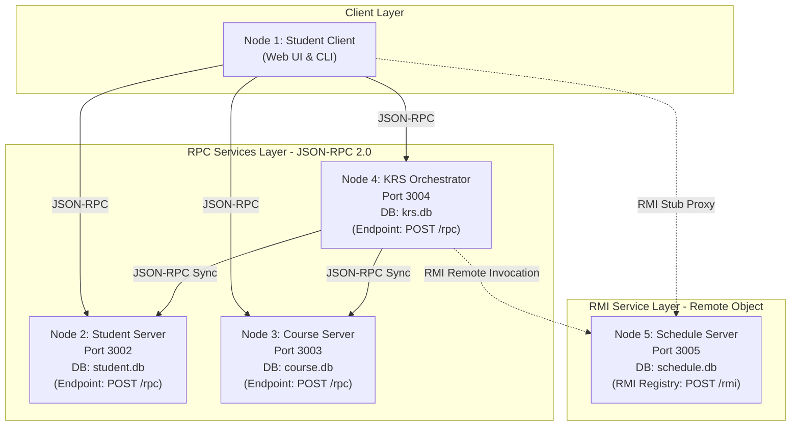
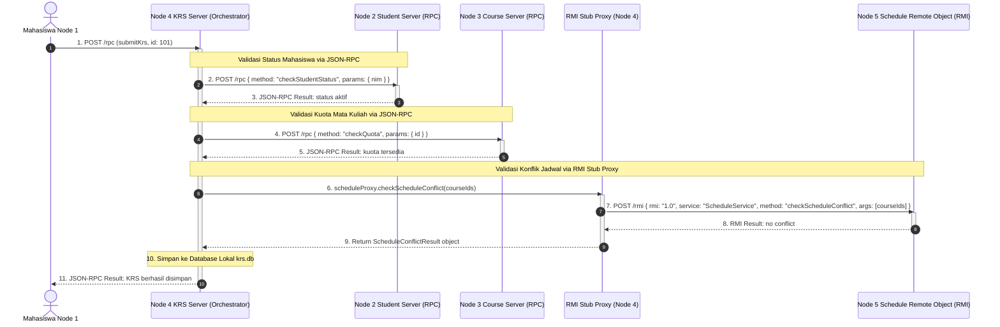

# CONCEPT.md - Arsitektur Hybrid: Sistem Akademik Terdistribusi (RPC & RMI)

Dokumentasi ini menjelaskan implementasi Sistem Terdistribusi multi-node yang menggabungkan dua paradigma utama:
1. **RPC (*Remote Procedure Call*)** berbasis standar **JSON-RPC 2.0** pada Node 2, Node 3, dan Node 4.
2. **RMI (*Remote Method Invocation*)** berbasis **Distributed Remote Object & Client Stub Proxy** pada Node 5.

---

## 1. Arsitektur Topologi Sistem

---

## 2. Diagram Alur: Submit KRS (Hybrid RPC & RMI Flow)

Diagram sekuensial berikut menunjukkan interaksi saat mahasiswa melakukan submit KRS di mana Node 4 memanggil Node 2 & Node 3 via RPC, serta memanggil Node 5 via RMI Stub Proxy:

---

## 3. Komparasi Protokol: RPC vs RMI dalam Sistem Ini

| Aspek | Node 2, 3, 4 (JSON-RPC 2.0) | Node 5 (RMI - Remote Method Invocation) |
| :--- | :--- | :--- |
| **Paradigma** | Berorientasi Prosedur/Fungsi (*Procedural*) | Berorientasi Objek (*Object-Oriented*) |
| **Pemanggilan di Client** | `callJsonRpc(url, "methodName", { params })` | `proxy.methodName(arg1, arg2)` via Client Stub Proxy |
| **Server-Side Dispatcher** | Router mencocokkan string method ke handler fungsi | `RmiRegistry` mencari instans *Servant* dan memanggil method pada objek |
| **Payload Spesifikasi** | `{ jsonrpc: "2.0", method: "...", params: {...}, id: ... }` | `{ rmi: "1.0", service: "ScheduleService", method: "...", args: [...], id: ... }` |
| **Lokasi Utilitas** | `src/utils/jsonrpc.util.ts` | `src/utils/rmi.util.ts` |

---

## 4. Ringkasan Node dan Protokol

| Node | Peran | Database | Port | Protokol Utama | Endpoint |
| :--- | :--- | :--- | :--- | :--- | :--- |
| **Node 1** | Student Client (Web UI & CLI) | - | 5173 | Client (RPC + RMI Stub) | - |
| **Node 2** | Student Server | `student.db` | `3002` | JSON-RPC 2.0 | `POST /rpc` |
| **Node 3** | Course Server | `course.db` | `3003` | JSON-RPC 2.0 | `POST /rpc` |
| **Node 4** | KRS Server (Orchestrator) | `krs.db` | `3004` | JSON-RPC 2.0 + RMI Client | `POST /rpc` |
| **Node 5** | Schedule Server | `schedule.db` | `3005` | **RMI (Remote Object)** | `POST /rmi` |

---

## 5. Daftar Method Remote per Node

### Node 2 (Student Server - RPC)
* `getAllStudents`: `params: {}`
* `getStudentByNim`: `params: { nim }`
* `getStudentStatus`: `params: { nim }`
* `createStudent`: `params: { nim, nama, status }`

### Node 3 (Course Server - RPC)
* `getAllCourses`: `params: {}`
* `getCourseByKode`: `params: { kode }`
* `getCourseById`: `params: { id }`
* `checkQuota`: `params: { id }`

### Node 4 (KRS Server - RPC Orchestrator)
* `submitKrs`: `params: { nim, courseIds }` -> Orkestrasi RPC ke Node 2 & 3, serta RMI ke Node 5.
* `getAllKrs`: `params: {}` -> Mengambil semua KRS yang diperkaya dengan detail matkul dari Node 3.
* `getKrsById`: `params: { id }`
* `getKrsByNim`: `params: { nim }`

### Node 5 (Schedule Server - RMI `ScheduleService`)
* `getAllSchedules()` -> Mengambil semua jadwal.
* `getScheduleByCourseId(courseId: number)` -> Mengambil jadwal mata kuliah.
* `getScheduleByDay(day: string)` -> Mengambil jadwal berdasarkan hari.
* `checkScheduleConflict(courseIds: number[])` -> Memeriksa bentrok jam perkuliahan antar-mata kuliah.
