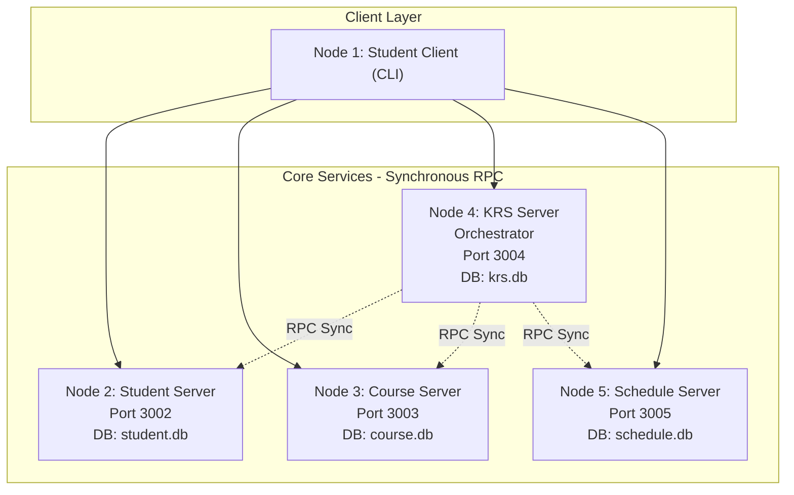
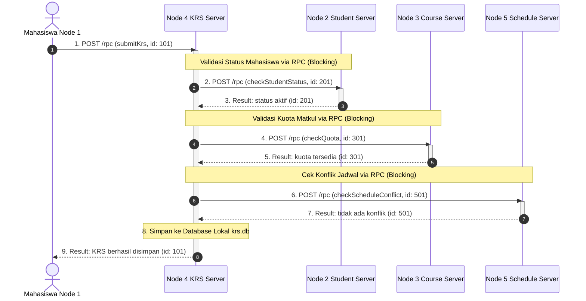
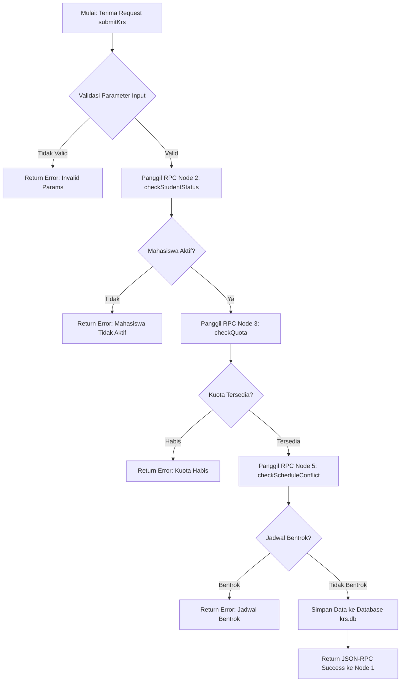
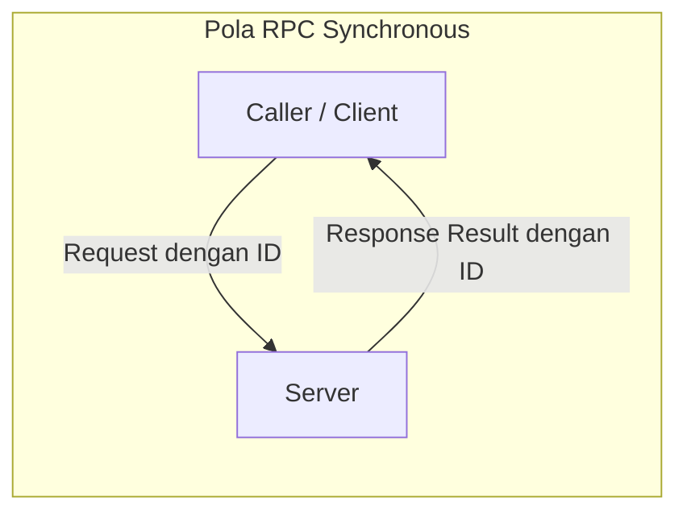

# CONCEPT.md - Konsep Sistem Akademik Terdistribusi (JSON-RPC 2.0)

Dokumentasi ini menjelaskan simulasi sistem KRS (Kartu Rencana Studi) terdistribusi yang terdiri dari 5 node/service independen, dengan menerapkan Remote Procedure Call (RPC) secara penuh berbasis protokol standar JSON-RPC 2.0.

---

## 1. Arsitektur Topologi Sistem

---

## 2. Diagram Alur Lengkap: Submit KRS (Full RPC Flow)

Diagram sekuensial berikut mendemonstrasikan bagaimana seluruh komunikasi antar-node menggunakan RPC (Blocking Synchronous) saat seorang mahasiswa melakukan pengisian KRS:

---

## 3. Flowchart Logika Eksekusi Node 4 (Orkestrator)

---

## 4. Mekanisme RPC (Spesifikasi JSON-RPC 2.0)

Seluruh komunikasi antar-node menggunakan pola RPC Synchronous (Blocking Request/Response):

Setiap request JSON-RPC 2.0 wajib menyertakan field `id` dan server wajib mengembalikan response dengan `id` yang sama. Caller akan menunggu (blocking) sampai response diterima sebelum melanjutkan eksekusi.

---

## 5. Ringkasan Node dan Port

| Node | Peran | Database | Port | Endpoint |
| :--- | :--- | :--- | :--- | :--- |
| **Node 1** | Student Client (CLI) | - | - | Client Only |
| **Node 2** | Student Server | `student.db` | `3002` | `POST /rpc` |
| **Node 3** | Course Server | `course.db` | `3003` | `POST /rpc` |
| **Node 4** | KRS Server (Orkestrator) | `krs.db` | `3004` | `POST /rpc` |
| **Node 5** | Schedule Server | `schedule.db` | `3005` | `POST /rpc` |

---

## 6. Daftar Method JSON-RPC 2.0 per Node

### Node 2 (Student Server)
* `getAllStudents`: `params: {}` -> Mengambil semua data mahasiswa.
* `getStudentByNim`: `params: { nim }` -> Mencari mahasiswa berdasarkan NIM.
* `getStudentStatus`: `params: { nim }` -> Mengecek status keaktifan (aktif, cuti, non-aktif).
* `createStudent`: `params: { nim, nama, status }` -> Menambahkan mahasiswa baru.

### Node 3 (Course Server)
* `getAllCourses`: `params: {}` -> Mengambil semua mata kuliah.
* `getCourseByKode`: `params: { kode }` -> Mencari mata kuliah berdasarkan kode.
* `getCourseById`: `params: { id }` -> Mencari mata kuliah berdasarkan ID.
* `checkQuota`: `params: { id }` -> Mengecek ketersediaan kuota.

### Node 4 (KRS Server - Orkestrator)
* `submitKrs`: `params: { nim, courseIds }` -> Orkestrasi validasi ke Node 2, 3, dan 5 via RPC, lalu simpan ke DB.
* `getAllKrs`: `params: {}` -> Mengambil semua KRS yang telah diagregasi dengan detail matkul dari Node 3.
* `getKrsById`: `params: { id }` -> Mengambil detail 1 KRS berdasarkan ID.
* `getKrsByNim`: `params: { nim }` -> Mengambil daftar riwayat KRS per NIM.

### Node 5 (Schedule Server)
* `getScheduleByCourseId`: `params: { courseId }` -> Mengambil jadwal berdasarkan ID mata kuliah.
* `getAllSchedules`: `params: {}` -> Mengambil seluruh daftar jadwal.
* `getScheduleByDay`: `params: { day }` -> Mengambil jadwal berdasarkan hari tertentu.
* `checkScheduleConflict`: `params: { courseIds }` -> Mengecek apakah ada bentrok jadwal antar mata kuliah yang dipilih.
